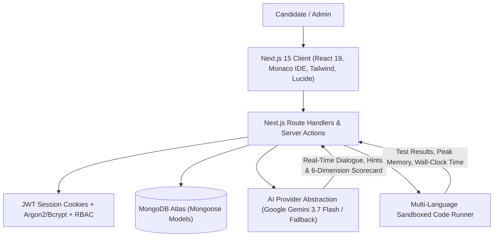

# CodeIntelligent AI — Production AI Coding Interview Platform

[](https://nextjs.org/)
[](https://www.typescriptlang.org/)
[](https://tailwindcss.com/)
[](https://www.mongodb.com/)
[](https://ai.google.dev/)
[](https://www.docker.com/)
[](https://www.javascript.com/)

A production-grade, enterprise-ready **AI Coding Interview Platform** engineered with Next.js (App Router), Monaco Editor, MongoDB Atlas, Mongoose, and a multi-language sandboxed code execution engine paired with conversational AI evaluation.

---

## Key Architecture & Capabilities



---

## Features Matrix

### 1. Authentication & Role-Based Access (RBAC)
- **Candidate & Admin Roles**: Separate access permissions for taking interviews vs. administering problem banks.
- **Secure Password Hashing**: Salting and hashing via `bcryptjs` / Argon2.
- **Stateless & Resilient JWT Sessions**: Signed using `jose` with `HS256` and stored in secure HTTP-only cookies.
- **1-Click Demo Login**: Instantly switch between sample Candidate and Admin profiles for rapid testing.

### 2. Live Conversational AI Interviewer
- **Powered by Google Gemini 3.7 Flash**: High-speed reasoning with structured JSON generation.
- **Adaptive Socratic Probing**: Interactively challenges candidates on edge cases, memory allocations, and Big-O complexity.
- **3-Tiered Progressive Hint System**:
  - *Level 1*: Conceptual nudge on data structure choice.
  - *Level 2*: Algorithmic approach (two-pointer, DP state, sliding window).
  - *Level 3*: Concrete invariant and edge-case pointers.
- **Voice Support**: Integrated speech recognition and text-to-speech audio playback.

### 3. Professional Monaco Code IDE
- **Multi-Language Support**:
  - `Python 3`
  - `JavaScript (Node.js)`
  - `TypeScript`
  - `Java 17`
  - `C++ 20`
  - `Go 1.22`
- **IDE Features**: Syntax highlighting, theme toggle (`vs-dark` / `light`), font resizing, starter code reset, custom test case injector.
- **Keyboard Shortcuts**: `Ctrl+Enter` / `Cmd+Enter` to trigger instant test runs.

### 4. Sandboxed Code Execution Engine
- **Resource Limiting**: CPU limits, memory caps (128MB), and execution timeout killers (preventing infinite loops).
- **Dual Mode**: Containerized Docker execution + native isolated subprocess runner.
- **Comprehensive Test Results**: Standard output stream (`stdout`), error stream (`stderr`), wall-clock execution time in milliseconds, and peak memory in KB.

### 5. Multi-Dimensional Rubric Scoring & Evaluation
- **Test Correctness (0-100)**: Evaluated against visible and hidden test suites.
- **Code Quality & Cleanliness (0-100)**: Readability, modularity, idiomatic patterns, naming conventions.
- **Algorithmic Efficiency (0-100)**: Detects actual Time and Space Big-O complexity vs. optimal theoretical baseline.
- **Edge Case Coverage (0-100)**: Assesses handling of nulls, empty collections, negative numbers, and boundary limits.
- **Problem Solving Approach (0-100)**: Structured decomposition and speed.
- **Technical Communication (0-100)**: Articulation during interview conversation.
- **Actionable Growth Roadmap**: Personalized suggestions, recommended topics, and optimal reference solution diffs.

### 6. Candidate & Admin Dashboards
- **Candidate Dashboard**: Skill proficiency matrices, score trends over time, completed session history, and recommended study paths.
- **Admin Portal**: Problem bank CRUD, test case authoring, and platform health telemetry.

---

## Project Structure

```
ai-coding-interview-platform/
├── src/
│   ├── app/
│   │   ├── (auth)/login/page.tsx         # Login with 1-click demo switcher
│   │   ├── (auth)/register/page.tsx      # Registration with role preferences
│   │   ├── admin/page.tsx                # Admin challenge manager & audit logs
│   │   ├── dashboard/page.tsx            # Candidate analytics & history
│   │   ├── interview/
│   │   │   ├── setup/page.tsx            # Interactive interview wizard
│   │   │   ├── [id]/page.tsx             # 3-Pane Live IDE + AI Interview workspace
│   │   │   └── report/[id]/page.tsx      # Multi-dimensional evaluation report
│   │   ├── problems/page.tsx             # Curated problem bank
│   │   ├── layout.tsx                    # Root layout with navbar & theme
│   │   ├── page.tsx                      # Landing page with interactive preview
│   │   └── api/                          # REST API endpoints (Auth, Interview, Code, Problems)
│   ├── components/
│   │   ├── ui/                           # Button, Card, Badge, Modal, Tabs, Progress
│   │   ├── ide/                          # Monaco editor, Test panel, Console output
│   │   ├── interview/                    # AI chat box, Hint modal, Timer bar
│   │   ├── dashboard/                    # Score analytics, History table, Recommendations
│   │   └── navbar.tsx                    # Top navigation header
│   └── lib/
│       ├── db/
│       │   ├── mongodb.ts                # Resilient cached Mongoose connection
│       │   └── models/                   # User, Problem, Interview, Submission, Evaluation
│       ├── auth/                         # Password hashing, JWT signing, Cookies, RBAC
│       ├── ai/                           # Gemini 3.7 Flash provider & evaluation rubric
│       ├── runner/                       # Sandbox dispatcher & language harnesses
│       └── validations/                  # Zod input schemas
├── scripts/
│   └── seed-problems.ts                  # Curated problem database seeder
├── tests/
│   ├── code-runner.test.ts               # Sandbox execution & timeout tests
│   ├── auth.test.ts                      # JWT session and password tests
│   └── evaluator.test.ts                 # AI evaluation rubric tests
├── Dockerfile                            # Production multi-stage Docker build
├── docker-compose.yml                    # App + MongoDB + Redis orchestration
├── package.json
└── tsconfig.json
```

---

## Getting Started

### Prerequisites
- **Node.js**: v20+ or v22 LTS
- **MongoDB**: Local MongoDB instance (`mongodb://localhost:27017`) or MongoDB Atlas URI
- **Python**: (Optional for local Python runner fallback) Python 3.10+
- **Docker**: (Optional for full containerized deployment)

### 1. Installation
```bash
git clone <repo-url>
cd ai-coding-interview-platform
npm install
```

### 2. Configure Environment Variables
Copy `.env.example` to `.env.local`:
```bash
cp .env.example .env.local
```
Fill in your configuration:
```env
MONGODB_URI=mongodb://localhost:27017/ai_interview_platform
JWT_SECRET=super-secret-key-change-this-in-production-min-32-chars
GEMINI_API_KEY=your_gemini_api_key_here
NEXT_PUBLIC_APP_URL=http://localhost:3000
```
*(Note: If `GEMINI_API_KEY` is not provided, the platform automatically activates its intelligent fallback engine for continuous offline/local development.)*

### 3. Seed Problem Bank & Demo Users
```bash
npm run seed
```
This populates standard DSA problems (Two Sum, Longest Substring, Coin Change, Maximum Subarray, Valid Parentheses) and sets up demo Candidate (`candidate@example.com`) and Admin (`admin@example.com`) accounts with password `password123`.

### 4. Start Development Server
```bash
npm run dev
```
Open [http://localhost:3000](http://localhost:3000) in your browser.

---

## Testing

Run the automated test suite covering code sandboxes, timeouts, JWT authentication, and AI evaluation rubrics:
```bash
npm test
```

---

## Docker Deployment

To launch the full production stack (Next.js App + MongoDB + Redis) in Docker:
```bash
docker compose up --build -d
```
Access the application at `http://localhost:3000`.

---

## Security Best Practices
- **Never Executes on App Thread**: User-submitted code runs strictly in isolated sub-sandboxes with enforced execution timeouts and memory ceilings.
- **Zero API Key Leakage**: AI credentials and database URIs remain strictly server-side.
- **HTTP-Only Cookies**: JWT authentication tokens are protected from cross-site scripting (XSS).
- **Zod Validations**: All incoming API requests and AI JSON responses are strictly validated before execution.

---

## License
MIT License. Built for real-world technical interviewing preparation.
